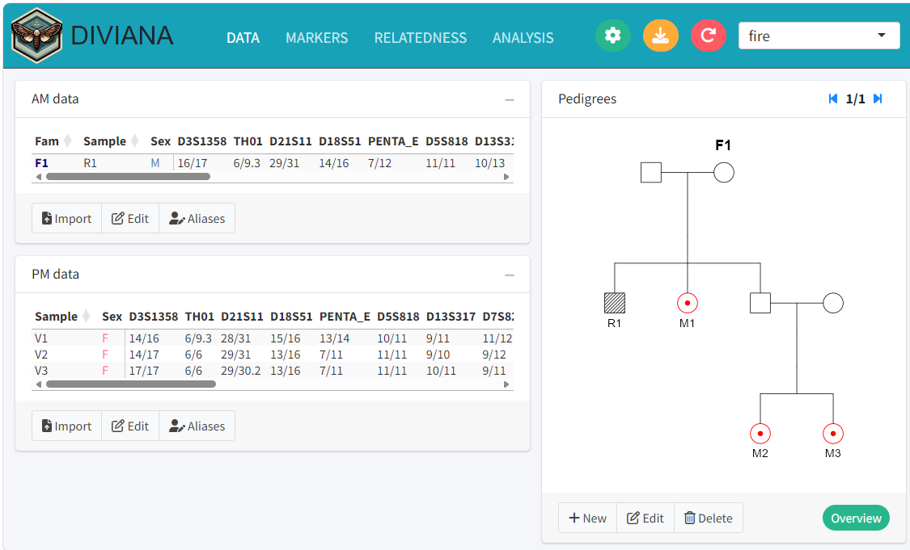

<!-- README.md is generated from README.Rmd. Please edit that file -->

# DIVIANA

DIVIANA is a Shiny app for DNA-based disaster victim identification
(DVI) and missing person cases. It combines data management, pedigree
editing and joint identification, including families with multiple
missing persons.

The analyses use [dvir](https://github.com/magnusdv/dvir), part of the
[pedsuite](https://pedsuite.org/) collection of R packages for pedigree
analysis. The methods are described in:

- Vigeland & Egeland (2021): [Joint DNA-based disaster victim
  identification](https://doi.org/10.1038/s41598-021-93071-5)
- Egeland & Vigeland (2025): [Kinship cases with partially specified
  hypotheses](https://doi.org/10.1016/j.fsigen.2025.103270)

Try the [online version of
DIVIANA](https://magnusdv.shinyapps.io/diviana/).

## Input data

DVI cases typically involve two types of samples: PM (post-mortem)
samples from unidentified remains, and AM (ante-mortem) samples from
relatives of the missing persons. Pedigree information is required to
link the AM samples to the missing persons.

DIVIANA supports the following input formats:

- **AM and PM profiles:** Text files (`.csv`, `.tsv`, `.txt`) with
  either one genotype column or two allele columns per marker. Some
  GeneMapper export formats are also supported.
- **Complete datasets:** Reload datasets previously saved, or import
  `.fam` files exported from the DVI module of
  [Familias](https://familias.no/).
- **Pedigrees:** Interactive pedigree builder and editor, with automatic
  construction from relationship information in AM tables.
- **Aliases:** Simplify long or cumbersome AM and PM sample names for
  clearer tables and plots, without changing the original identifiers.

## Analysis

- **Quality control:** Pairwise relatedness checks, including
  consistency checks of AM pedigrees.
- **Merging of PM samples:** LR-based analysis supporting dropout,
  drop-in and typing errors.
- **Main analysis:** Pairwise LRs, exclusions and joint identification
  of multiple missing persons.
- **Results:** AM and PM summaries, LR and exclusion matrices, and joint
  assignment tables, with Excel export. Solutions are also displayed as
  pedigree plots.

## Running DIVIANA locally

For sensitive data, run DIVIANA locally on your computer. Install the R
package from GitHub:

``` r
# install.packages("remotes")
remotes::install_github("magnusdv/diviana", dependencies = TRUE)
```

Launch the app with:

``` r
diviana::launchApp()
```


